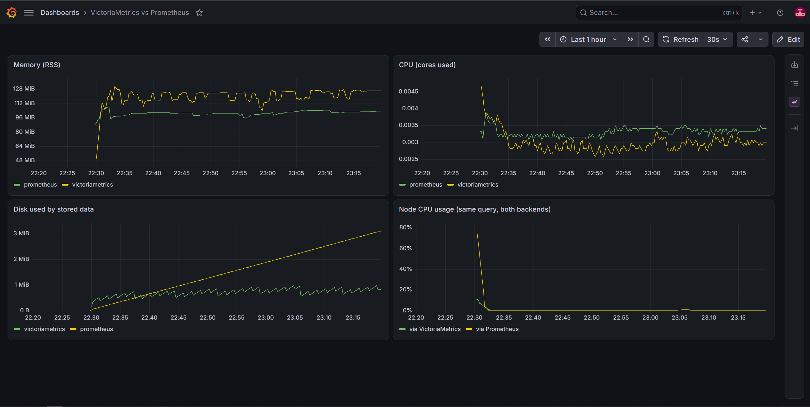

# VictoriaMetrics vs Prometheus

I wanted to actually try VictoriaMetrics instead of just reading about it, so I set it up next to Prometheus on my own machine. Both scrape the exact same targets, Grafana is pointed at both, and I compared how much CPU, memory and disk each one uses for the same data.

## What's running

- **node-exporter** (9100): real host metrics from my machine
- **Prometheus** (9090): the baseline
- **VictoriaMetrics** single-node (8428): scrapes the same `prometheus.yml` as Prometheus
- **Grafana** (3000): both added as datasources, plus a dashboard comparing them
- **avalanche** (9001, optional): fake load, about 10k series that stay stable

## How to run it

```bash
docker compose up -d                    # start without load
docker compose --profile load up -d     # add the fake load
./compare.sh                            # CPU, memory, disk and series for both
```

If you're on Windows with Git Bash, run the script like this instead: `MSYS_NO_PATHCONV=1 bash compare.sh`. Otherwise Git Bash messes up the container paths (found that out the hard way).

Grafana is at localhost:3000 (admin / admin), dashboard is called "VictoriaMetrics vs Prometheus". VictoriaMetrics also has its own UI at localhost:8428/vmui.

## Results

Ran it on Windows with Docker Desktop (30 GB RAM). About 30 min without load, then around 2 hours with it.

| | Prometheus | VictoriaMetrics |
|---|---|---|
| Series (idle / load) | 3,023 / 12,905 | 3,008 / 12,878 |
| Memory (idle / load) | 54.5 MiB / 142.8 MiB | 102.2 MiB / 93.4 MiB |
| Disk (idle / load) | 2.4 MB / 53.2 MB | 1.5 MB / 10.2 MB |
| CPU (idle / load) | 0.49% / 0.26% | 0.24% / 0.09% |

Without load:



With load:


## What I noticed

**Setup was really easy.** I just pointed VictoriaMetrics at the same Prometheus scrape config with one flag and it worked. Grafana connects to it with the normal Prometheus datasource, and running the same query on both gave me the same graph.

**Memory surprised me a bit.** Without load, Prometheus was actually lighter (54 vs 102 MiB). But once I added the load, Prometheus went up to 143 MiB and VictoriaMetrics basically didn't move. So it looks like VM has a higher starting point but doesn't really grow with more series, at least at this size.

**Disk was about 5x smaller on VictoriaMetrics** (10 vs 53 MB for the same data). To be fair though, after 2 hours most of Prometheus's data is probably still in its WAL and hasn't been compacted yet, so the gap would likely shrink on a longer run.

**The best part was a mistake.** My first load test used avalanche's default settings, which turned out to create about 50k series and replace them every minute. Prometheus just took all of it and ended up at around 3 million series and 4.5 GB of RAM. VictoriaMetrics refused it completely, because the metrics page was bigger than its default 16 MB scrape limit (`-promscrape.maxScrapeSize`). The targets page showed a clear error that even told me which flag to change.

At first my numbers looked amazing for VictoriaMetrics, until I noticed it had like 3k series vs Prometheus's 3 million, so it wasn't storing the same data at all. I made the load smaller and steady, wiped everything and ran it again. That's what the numbers above are from. Honestly I like that limit, one broken exporter can't take down your whole monitoring setup by default.

**CPU** was under 1% on both the whole time, so not much to compare there.

## Keep in mind

This was one machine and a couple of hours, not a real benchmark. With more data, longer retention or heavy querying the numbers would look different.
