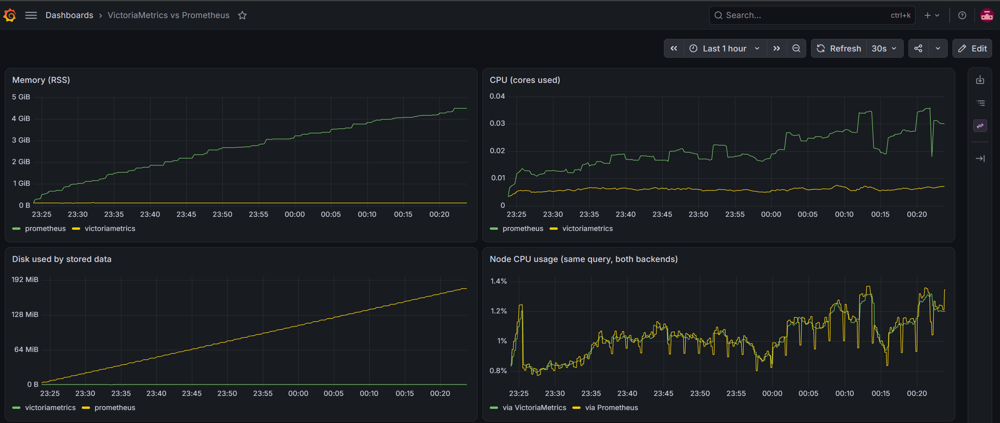

# VictoriaMetrics vs Prometheus: hands-on comparison

A small local lab to get familiar with VictoriaMetrics: run it next to Prometheus, have both scrape the exact same targets, point Grafana at both, and compare what each one costs in CPU, memory and disk.

## What's in the stack

| Service | Port | Role |
|---|---|---|
| node-exporter | 9100 | Host metrics (the "real" workload) |
| Prometheus | 9090 | Baseline TSDB |
| VictoriaMetrics (single-node) | 8428 | Scrapes the same `prometheus.yml` via `-promscrape.config` |
| Grafana | 3000 | Both provisioned as datasources, plus a comparison dashboard |
| avalanche (optional) | 9001 | Synthetic load: 100 metrics x 100 series, ~10k series, no churn |

## Run it

```bash
docker compose up -d                    # idle baseline
docker compose --profile load up -d     # add synthetic load
./compare.sh                            # snapshot of CPU, memory, disk, series
```

On Windows Git Bash, run the script as `MSYS_NO_PATHCONV=1 bash compare.sh`, otherwise Git Bash rewrites the container paths.

Grafana: http://localhost:3000 (admin / admin), dashboard "VictoriaMetrics vs Prometheus".
VictoriaMetrics UI (vmui): http://localhost:8428/vmui

## Results

Machine: Windows, Docker Desktop, 30 GB RAM available to Docker
Run length: ~30 min idle, then ~2 hours under load

| Metric | Prometheus | VictoriaMetrics |
|---|---|---|
| Active series (idle / load) | 3,023 / 12,905 | 3,008 / 12,878 |
| Memory (idle / load) | 54.5 MiB / 142.8 MiB | 102.2 MiB / 93.4 MiB |
| Disk (idle / load) | 2.4 MB / 53.2 MB | 1.5 MB / 10.2 MB |
| CPU (snapshot, idle / load) | 0.49% / 0.26% | 0.24% / 0.09% |



## What I noticed

**Setup was basically zero effort.** VictoriaMetrics read the existing Prometheus scrape config with one flag (`-promscrape.config`), no changes. Grafana talks to it through the standard Prometheus datasource, and the same PromQL query returned the same graph from both backends.

**Memory: Prometheus grew with the data, VictoriaMetrics didn't.** At idle Prometheus was actually lighter (54 MiB vs 102 MiB). Under ~13k series Prometheus went up ~2.6x to 143 MiB, while VictoriaMetrics stayed flat around 93-102 MiB. So VM's memory looks more like a fixed baseline, and Prometheus scales with series count.

**Disk: about 5x smaller on VictoriaMetrics** (10.2 MB vs 53.2 MB for the same data). One caveat: at ~2 hours most of Prometheus's data is still in its WAL, which isn't compressed into blocks until compaction kicks in, so a longer run would likely narrow the gap somewhat.

**The most interesting finding was an accident.** My first load test used avalanche's defaults, which churn ~50k series every minute. Prometheus ingested all of it and climbed to ~3M series and 4.5 GB of RAM. VictoriaMetrics refused the scrape entirely: the response was bigger than its default 16 MB `-promscrape.maxScrapeSize` limit, and the targets page showed a clear error naming the exact flag and config option to change. That's a sensible guardrail, a single misbehaving exporter can't blow up the monitoring system by default. It also meant that first comparison was invalid (VM never stored the data), so I shrank the load to a steady ~10k series and reran from scratch.

**CPU** was too low on both to say much from a point-in-time snapshot. Both stayed under 1%.

## Caveats

This is a short single-machine test, not a production benchmark. Numbers will differ with retention, cardinality, churn and query load.
